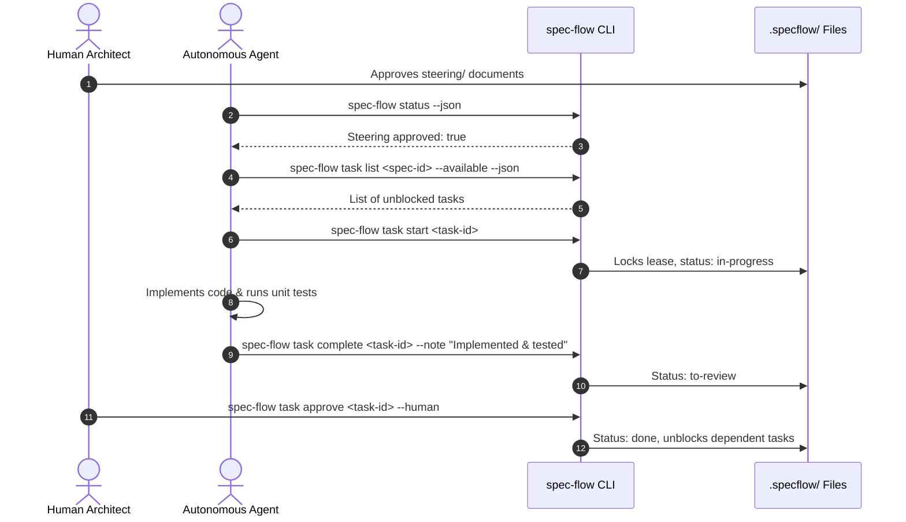

# Developer & Agent Onboarding Guide

## Quickstart

### Prerequisites
- [Bun](https://bun.sh) (v1.3+ recommended) or Node.js v20+

### 1. Build and Test
```bash
# Run unit tests across domain core
bun test packages/core

# Run linting
bun run lint
```

### 2. Initializing a Repository
To start using Spec-Flow in any repository:
```bash
bun packages/cli/src/bin.ts init
```
This scaffolds:
- `.specflow/`: Configuration, steering documents, and feature specifications.
- `docs/`: Long-term architectural context and progress logs.

### 3. Launching the Web Dashboard
```bash
bun packages/cli/src/bin.ts dashboard
```
Opens the real-time Spec-Flow dashboard at `http://127.0.0.1:4200`.

---

## Autonomous Agent Workflow



### Golden Rules for Agents
1. Always check `spec-flow status` first. Never write code if steering is not approved.
2. Only claim tasks that are marked `available`. Never jump blocked tasks.
3. You **cannot** mark tasks as `done`. You must submit via `spec-flow task complete <task-id>`.
4. Monitor human feedback frequently: `spec-flow comment list --pending`.
