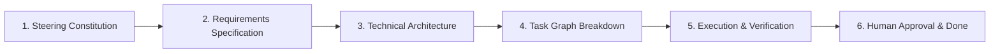

# Spec-Driven Development (SDD) Workflow Guide

This guide establishes the end-to-end operational protocol for autonomous AI agents and human architects collaborating within Spec-Flow.

---

## 1. The SDD Lifecycle Stages



### Stage 1: Steering Constitution
1. Scaffolds `product.md`, `tech.md`, and `structure.md` in `.specflow/steering/`.
2. Defines product goals, technical stack, coding standards, directory organization, and non-negotiable boundaries.
3. **Gate Requirement**: A human architect must inspect and approve all steering documents (`spec-flow steering approve <id>`). Agents cannot scaffold specs until this gate passes.

### Stage 2: Requirements (`requirements.md`)
1. Translates user stories into numbered functional requirements (`REQ-1`, `REQ-2`).
2. Documents concrete acceptance criteria using Gherkin syntax (`GIVEN ... WHEN ... THEN ...`).
3. Outlines non-functional requirements (performance, security, modularity, reliability).

### Stage 3: Technical Design (`design.md`)
1. Details system architecture, component contracts, and data structures.
2. Performs code reuse analysis to leverage existing services and utilities.
3. Documents error handling strategies and testing approaches.

### Stage 4: Tasks Breakdown (`tasks.yaml`)
1. Divides the technical implementation into small, atomic tasks and hierarchical subtasks.
2. Identifies parallel tracks and explicit prerequisite dependencies (`depends_on`).
3. Specifies suggested branch naming patterns and conventional commit patterns.

### Stage 5: Execution, Testing & Review
1. Agent claims an available task (`status: todo` $\to$ `status: in-progress`).
2. Creates isolated feature branch or worktree (`git checkout -b <branch>`).
3. Implements domain logic using Test-Driven Development (TDD).
4. Commits changes using conventional commit pattern (`feat(<spec>): <task title> (refs #<task-id>)`).
5. **Pre-flight Check**: Agent executes `spec-flow doctor` (or `spec-flow check`) to verify schema and graph integrity.
6. Submits task for review (`spec-flow task submit <spec> <task-id> --note "..."`).

### Stage 6: Human Verification & HITL Approval
1. Human reviews implementation in dashboard or terminal.
2. Leaves anchored line comments if changes are needed.
3. If changes requested: clicks "Request Changes" $\to$ task returns to `todo`.
4. If verified complete: clicks "Approve (Human)" $\to$ task marked `done`.

---

## 2. Branching & Commit Message Conventions

### Branch Naming Patterns
- For specification features: `spec/<spec-id>`
- For individual task execution: `feature/<spec-id>/<task-id>` or `feat/<spec-id>-<task-id>`
- Example: `feature/demo-spec/2.1`

### Conventional Commit Patterns
To maintain clean git history and link commits with tasks:
- **Format**: `<type>(<spec-id>): <task-title> (refs #<task-id>)`
- **Examples**:
  - `feat(demo-spec): implement JWT token rotation middleware (refs #2.1)`
  - `fix(demo-spec): correct token signature verification (refs #2.1)`
  - `test(demo-spec): add unit tests for RBAC permission matrix (refs #2.2)`
  - `docs(demo-spec): update architecture diagrams (refs #REQ-3)`

---

## 3. Pre-Flight Verification (`spec-flow doctor`)

Before submitting a task or merging code, autonomous AI agents MUST run:

```bash
spec-flow doctor
```

If any errors are reported (schema violations, cyclic dependencies, missing documents), the agent must resolve them before requesting human review.
