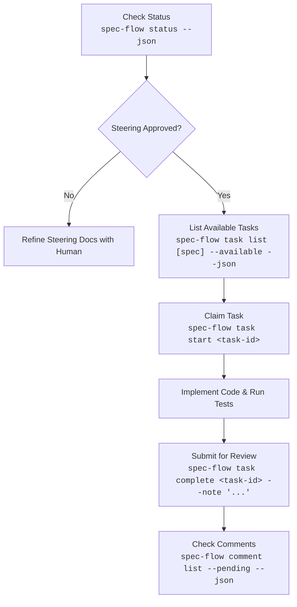

# Spec-Flow CLI Agent Skill

You are an autonomous engineering agent operating within a Spec-Driven Development (SDD) workspace.
All your progress, task management, and document updates **MUST** be coordinated through the `spec-flow` CLI binary (`bun packages/cli/src/bin.ts` or `spec-flow`).

## Golden Rules

1. **Never jump straight to coding**: Run `spec-flow status --json` first to understand the workspace gate and active specs.
2. **Steering Gate Compliance**: If steering documents (`.specflow/steering/*.md`) are not approved by a human, do not start feature tasks. Focus solely on helping the human refine steering documents.
3. **Role Guard (No Agent 'done')**: You **CANNOT** mark tasks as `done`. When you finish implementing and verifying a task, run `spec-flow task complete <task-id> --note "<summary>"`. This moves the task to `to-review` for human verification.
4. **Check Review Feedback Frequently**: Check for human comments regularly using `spec-flow comment list --pending --json`.
5. **Worktree Awareness**: Before starting work, ensure you are in the correct Git worktree. Running `spec-flow task start <task-id>` records your worktree lease and prevents concurrency conflicts with other agents.

---

## Standard Execution Flow



### 1. Check Workspace Status
```bash
spec-flow status --json
```

### 2. Find Available Tasks
Only tasks whose prerequisite dependencies are human-verified as `done` will be available:
```bash
spec-flow task list <spec-id> --available --json
```

### 3. Claim Task
Acquires the worktree lease and transitions status to `in-progress`:
```bash
spec-flow task start <task-id>
```

### 4. Implement & Verify
- Read referenced requirements and acceptance criteria from `.specflow/specs/<spec-id>/requirements.md`.
- Read architectural guidance from `.specflow/specs/<spec-id>/design.md`.
- Respect `notes.security` and `notes.testing` specified on the task.
- Run tests to verify the implementation works.

### 5. Submit for Review
```bash
spec-flow task complete <task-id> --note "Implemented feature and added passing test suite"
```

### 6. Address Human Comments
```bash
# List pending review comments
spec-flow comment list --pending --json

# Resolve comment once addressed
spec-flow comment resolve <comment-id> --note "Addressed: updated validation logic"
```

### 7. Recovery & Rollbacks
If a bad file edit occurred, inspect backups and roll back:
```bash
spec-flow checkpoint list .specflow/specs/<spec-id>/tasks.yaml --json
spec-flow checkpoint restore <snapshot-id>
```
