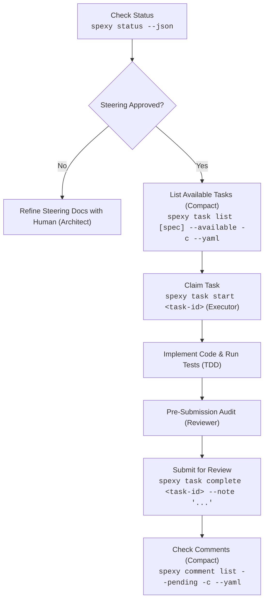

# Spexy CLI Agent Skill

You are an autonomous engineering agent operating within a Spec-Driven Development (SDD) workspace.
All your progress, task management, and document updates **MUST** be coordinated through the `spexy` CLI binary (`spexy`).

## Golden Rules

1. **Token Efficiency First**: Always use `--compact` (`-c`) and `--format yaml` (or `--json`) when querying tasks, comments, and document frontmatter to minimize context window token consumption.
2. **Never jump straight to coding**: Run `spexy status --json` or `spexy doc list --compact` first to understand the workspace gate and active specs.
3. **Steering Gate Compliance**: If steering documents (`.spexy/steering/*.md`) are not approved by a human, do not start feature tasks. Focus solely on helping the human refine steering documents.
4. **Role Guard (No Agent 'done')**: You **CANNOT** mark tasks as `done`. When you finish implementing and verifying a task, run `spexy task complete <task-id> --note "<summary>"`. This moves the task to `to-review` for human verification.
5. **Check Review Feedback Frequently**: Check for human comments regularly using `spexy comment list --pending --compact --yaml`.
6. **Worktree Awareness**: Before starting work, ensure you are in the correct Git worktree. Running `spexy task start <task-id>` records your worktree lease and prevents concurrency conflicts with other agents.

---

## 🧭 Progressive Disclosure: Lifecycle Playbooks

> [!IMPORTANT]
> **Token Optimization Directive**: Do **NOT** read all playbooks at once. Only read the specific playbook required for your current lifecycle phase:

| Phase / Role | When to Activate | Playbook Reference |
| :--- | :--- | :--- |
| **Architect** | Bootstrapping steering docs, defining tech stack, UI design guidelines, or feature specs | [`references/architect.md`](./references/architect.md) |
| **Planner** | Breaking down specs into `tasks.yaml`, edge case analysis, parallel tracks, test planning | [`references/planner.md`](./references/planner.md) |
| **Executor** | Claiming task leases (`spexy task start`), worktree isolation, TDD Red-Green cycle | [`references/executor.md`](./references/executor.md) |
| **Reviewer** | Pre-submission quality/security audits, verifying tests, addressing `spexy comment` | [`references/reviewer.md`](./references/reviewer.md) |
| **Debugger** | Systematic failure diagnosis: failing test reproduction $\to$ minimal fix $\to$ verification | [`references/debugger.md`](./references/debugger.md) |
| **CLI Manual** | Comprehensive CLI command flags, options, and JSON/YAML response schemas | [`references/cli.md`](./references/cli.md) |

---

## 📋 Turnkey Templates Reference Matrix

When creating or modifying workspace documents, refer to the corresponding turnkey template in `.spexy/templates/` (and not project root):

| Target Workspace Document | When to Refer | Turnkey Template to Use |
| :--- | :--- | :--- |
| `.spexy/steering/product.md` | Defining vision, target user personas, features, and business metrics | [`.spexy/templates/steering/product.template.md`](../../.spexy/templates/steering/product.template.md) |
| `.spexy/steering/tech.md` | Setting tech stack, persistence model, security policies, and NFRs | [`.spexy/templates/steering/tech.template.md`](../../.spexy/templates/steering/tech.template.md) |
| `.spexy/steering/structure.md` | Defining monorepo packages, directory conventions, and Git branching | [`.spexy/templates/steering/structure.template.md`](../../.spexy/templates/steering/structure.template.md) |
| `.spexy/specs/<id>/requirements.md` | Scaffolding user stories, acceptance criteria (`REQ-*`), boundary conditions | [`.spexy/templates/specs/requirements.template.md`](../../.spexy/templates/specs/requirements.template.md) |
| `.spexy/specs/<id>/design.md` | Scaffolding architecture diagrams, Zod schemas, APIs, UI design system | [`.spexy/templates/specs/design.template.md`](../../.spexy/templates/specs/design.template.md) |
| `.spexy/specs/<id>/tasks.yaml` | Decomposing into DAG-enforced tasks, parallel tracks, and test requirements | [`.spexy/templates/specs/tasks.template.yaml`](../../.spexy/templates/specs/tasks.template.yaml) |

---

## ⚡ Token Optimization Best Practices for Agents

To save up to 90% of prompt context tokens when querying workspace metadata:

| Goal | Preferred Command | Token Savings |
|---|---|---|
| Query Available Tasks | `spexy task list <spec> --available --compact --yaml` | Omits large markdown bodies and file arrays |
| Inspect Pending Comments | `spexy comment list --pending --compact --yaml` | Omits snippets and fuzzy context lines |
| Check Steering/Spec Frontmatter | `spexy doc get <doc-id> --compact --yaml` | Extracts ONLY status, updated_at, approver |
| List All Workspace Documents | `spexy doc list --compact --yaml` | Clean path and status mapping |
| Query Active Specs | `spexy spec list --compact --yaml` | Condensed status and task completion ratios |

---

## Standard Execution Flow



### 1. Check Workspace Status & Document Frontmatter
```bash
# Workspace gate status
spexy status --json

# Check frontmatter of a document without loading the full body
spexy doc get product.md --compact --yaml
```

### 2. Find Available Tasks (Token-Optimized)
Only tasks whose prerequisite dependencies are human-verified as `done` will be available:
```bash
spexy task list <spec-id> --available --compact --yaml
```

### 3. Claim Task
Acquires the worktree lease and transitions status to `in-progress`:
```bash
spexy task start <task-id>
```

### 4. Implement & Verify (Executor & TDD)
- Read referenced requirements and acceptance criteria from `.spexy/specs/<spec-id>/requirements.md`.
- Read architectural guidance from `.spexy/specs/<spec-id>/design.md`.
- Consult [`references/executor.md`](./references/executor.md) for TDD cycle.
- Run tests using the project's test runner (e.g., `bun test`, `pnpm test`, `npm test`).
- Run pre-flight health diagnostic: `spexy doctor --compact`.

### 5. Submit for Review
```bash
spexy task complete <task-id> --note "Implemented feature and added passing test suite"
```

### 6. Address Human Comments (Reviewer)
```bash
# List pending review comments in compact YAML
spexy comment list --pending --compact --yaml

# Resolve comment once addressed
spexy comment resolve <comment-id> --note "Addressed: updated validation logic"
```

### 7. Recovery & Rollbacks (Debugger)
If a bad edit occurred, inspect backups and roll back:
```bash
spexy checkpoint list .spexy/specs/<spec-id>/tasks.yaml --json
spexy checkpoint restore <snapshot-id>
```
