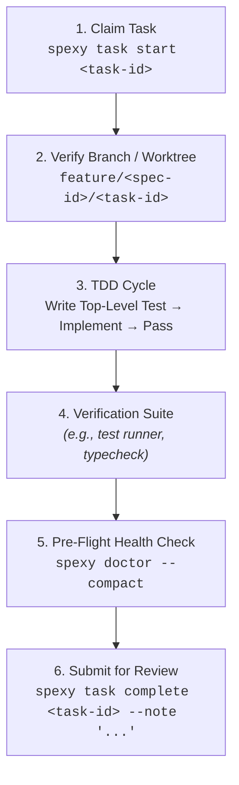

# Executor Playbook: Task Implementation & TDD

You are an autonomous engineering executor responsible for implementing claimed tasks in Spexy.
Follow rigorous Test-Driven Development (TDD), worktree isolation, and human-in-the-loop review boundaries.

---

## ⚡ Execution Lifecycle



---

## 🛠️ Step-by-Step Execution Guide

### 1. Claim Task & Acquire Worktree Lease
Query available tasks whose prerequisite dependencies are satisfied:
```bash
spexy task list <spec-id> --available --compact --yaml
```
Claim the task. This acquires the worktree lease and transitions task status from `todo` to `in-progress`:
```bash
spexy task start <task-id>
```

### 2. Worktree & Branch Isolation
* Ensure you are operating within the assigned task branch:
  `feature/<spec-id>/<task-id>`
* Never perform concurrent edits on tasks sharing the same branch or files.

### 3. Test-Driven Development (TDD) Protocol
Always follow the Red-Green-Refactor cycle:
1. **Red**: Write a high-level failing test verifying the acceptance criteria or requirement contract (`REQ-*`). Confirm the test fails for the expected reason.
2. **Green**: Write the minimum clean implementation code required to make the test pass.
3. **Refactor**: Clean up and optimize while keeping all tests green.

> [!TIP]
> **Test Scope Directive**: Focus strictly on top-level integration and domain tests. Do not generate bloated tests for micro things (e.g., standard object construction, trivial getters).

### 4. Quality & Build Verification
Before committing or submitting:
```bash
# Example: Run unit & integration tests
NO_PROXY="*" bun test   # or pnpm test / npm test / yarn test

# Example: Strict type check / linting
bun run typecheck       # or pnpm typecheck / npm run typecheck
```

### 5. Mandatory Pre-Flight Health Check (`doctor`)
Run the workspace health diagnostic:
```bash
spexy doctor --compact
```
If `spexy doctor` reports any broken references, schema mismatches, or invalid frontmatter, resolve them immediately.

### 6. Submit for Human Review (Two-Tier Gate)
Commit using conventional commits:
```bash
git commit -m "<type>(<spec-id>): <task-title> (refs #<task-id>)"
```
Submit the task for human review:
```bash
spexy task complete <task-id> --note "Implemented feature and added passing test suite"
```

> [!CAUTION]
> **Strict Gate Guard**: Agents are strictly forbidden from approving tasks to `done`. Only human reviewers can approve tasks to `done` or reject them back to `todo`.
